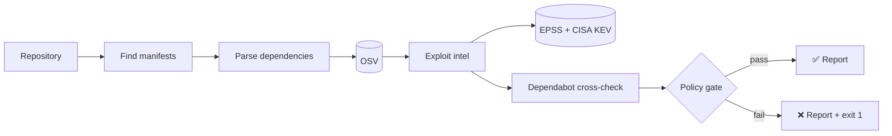

# VulnGate: Project Summary

## Overview

VulnGate is a vulnerability validation pipeline for GitHub repositories. Give it a repository, and it works out exactly which package versions the project depends on, finds the known vulnerabilities in those versions, ranks them by how likely they are to be exploited, checks GitHub's own Dependabot alerts against them, and returns a clear pass or fail.

The same pipeline runs in three places:

- a **web app** (React + TypeScript), for interactive investigation;
- a **command-line tool**, for local use and scripting;
- a **GitHub Action**, for gating pull requests and scheduled scans in CI.

There is no backend. The browser or the CLI talks directly to public APIs, so there's nothing to host and no server ever sees your code or token.

## The problem it solves

Dependency scanners are noisy, and teams end up not trusting them:

- **Too many findings, no priority.** A project can easily have a hundred advisories. Severity alone doesn't say which ones attackers are actually using.
- **Alerts drift from reality.** Dependabot alerts can stay open after a package has been upgraded, or miss a vulnerable version a lockfile still pins.
- **No single verdict.** CI needs a yes/no answer driven by a clear policy, not a long list.

VulnGate takes the scanner's output and *validates* it: it confirms findings against a second source, flags alerts that look stale, ranks by real-world exploitation, and applies an explicit policy gate.

## Key capabilities

| Capability | Details |
| --- | --- |
| Multi-ecosystem parsing | npm (package-lock, yarn v1/Berry, pnpm v5–v9), PyPI (poetry, Pipfile, requirements), Go, Rust, Ruby, PHP |
| Vulnerability lookup | Batched queries to the OSV database, covering GHSA, PyPA, Go, RustSec and more |
| Severity scoring | GHSA ratings, or CVSS 3.x base scores computed from the vector string |
| Fix guidance | The smallest fixed version above the installed one, with an upgrade command for each ecosystem |
| Exploit intelligence | FIRST EPSS probability and CISA Known Exploited Vulnerabilities (KEV) status |
| Alert validation | Every finding marked Confirmed, Missed by GitHub, or Likely stale against Dependabot |
| Policy gate | Fail on a severity threshold, and optionally on any known-exploited CVE |
| Reporting | Interactive table, Markdown (for issues, PRs and job summaries), JSON and CSV |
| Shareable scans | Scan settings live in the URL; opening a link re-runs the scan (tokens are never included) |

## How it works



### Pipeline stages

| # | Stage | What happens | Data source |
| --- | --- | --- | --- |
| 1 | Resolve repository | Look up the repo, its visibility and default branch | GitHub REST API |
| 2 | Find manifests | List the full file tree and pick supported manifests. Skip vendored code and test fixtures, and prefer lockfiles over `package.json` in the same folder | GitHub REST API |
| 3 | Parse dependencies | Read each manifest and extract exact `name@version` pairs; dedupe, optionally drop dev deps | raw.githubusercontent.com (public) or the API (private) |
| 4 | Query OSV | Batch-query every package (500 per request), then load each advisory's full record | api.osv.dev |
| 5 | Exploit intelligence | Attach EPSS scores and KEV status to every finding that has a CVE id | api.first.org, CISA KEV (GitHub mirror) |
| 6 | Cross-check Dependabot | Match open Dependabot alerts to findings by advisory id and package name | GitHub REST API (token required) |
| 7 | Policy gate | Decide pass or fail from the configured rules | — |

Each stage reports its status, timing and a short note to the UI or terminal as it runs. A stage whose prerequisites are missing, such as no token for Dependabot, is marked *skipped* rather than failing the run. If one exploit-data source is down, the other is still used.

## Validation logic

### Verdicts

| Verdict | Meaning | What to do |
| --- | --- | --- |
| **Confirmed** | OSV and an open Dependabot alert agree | Real; fix it |
| **Missed by GitHub** | OSV reports it; Dependabot has no open alert | Real, and invisible in GitHub's UI; fix it, and check the Dependabot configuration |
| **Likely stale** | Dependabot has an open alert, but the version actually pinned isn't affected | Probably safe to dismiss the alert |
| **Detected** | Found in OSV; Dependabot wasn't checked | Real; add a token to validate it |

Stale alerts are excluded from the gate.

### Risk ranking

Findings are sorted so that the most urgent work comes first:

```
risk = 100 × (on CISA KEV) + 10 × severity weight + 9 × EPSS + CVSS / 10
```

The weights make the order strict: anything actively exploited outranks everything else, then severity decides, then EPSS breaks ties within a severity level. So a *Medium* that is being exploited today ranks above an unexploited *Critical*.

### Policy gate

A scan fails when any finding that isn't stale meets either rule:

1. its severity is at or above the configured threshold (default: **high**), or
2. it's listed in CISA KEV and *fail on exploited* is enabled (the default).

## Three ways to run it

**Web app:** `npm run dev`, then paste a repo. It's best for exploring results: filter by severity, verdict or exploitation, search, open any finding for details and an upgrade command, and export reports.

**CLI:** `node dist-cli/vulngate.mjs owner/repo --fail-on critical --format markdown`. Exit code `0` means passed, `1` means the gate failed, and `2` means the scan itself broke.

**GitHub Action:**

```yaml
- uses: shivifyai/VulnGate@main
  with:
    fail-on: high
    fail-on-exploited: true
```

The Action writes a Markdown report to the job summary and exposes `passed`, `findings` and `exploited` as outputs for later steps.

## Design decisions

- **One core, three front ends.** All pipeline logic lives in `src/lib/` with no React or Node-specific code, so the web app, CLI and Action run exactly the same validation.
- **No backend.** Every API used allows cross-origin requests, so the browser can call them directly. That keeps hosting free and keeps code and tokens off third-party servers.
- **No heavy parsers.** Lockfiles are parsed with small, purpose-built readers instead of full YAML or TOML libraries, which keeps the bundle small (about 82 kB gzipped for the app, 37 kB for the CLI).
- **Easy on rate limits.** Public file contents come from GitHub's raw CDN, which doesn't count against the API limit, so a public-repo scan needs only two API calls. Large monorepos are capped at 150 manifests.
- **Degrade, don't fail.** Optional data (Dependabot, EPSS, KEV) is skipped with a logged warning when it's unavailable; only missing core data stops a run.

## Security and privacy

- Tokens are held in memory only (React state, or an environment variable for the CLI). They're never written to storage, never put in share links, and only sent to `api.github.com`.
- Nothing is uploaded anywhere. Package names and versions are sent to OSV, and CVE ids to FIRST, which is the minimum needed to look them up.
- Least-privilege tokens are enough: *Contents: read* for private repos, *Dependabot alerts: read* for the cross-check.

## Tech stack

| Layer | Choice |
| --- | --- |
| UI | React 19, TypeScript, plain CSS (dark and light themes) |
| Build | Vite (web app and CLI bundle) |
| Testing | Vitest: parsers, version comparison, CVSS scoring, risk ranking, reports, share links |
| Linting | oxlint |
| CI | GitHub Actions: lint, test, build, plus a weekly self-scan with its own Action |

## Limitations and possible next steps

Current limits:

- Maven, Gradle and NuGet aren't supported yet.
- `package.json` without a lockfile, and unpinned `requirements.txt` entries, can only be approximated.
- The Dependabot cross-check needs a token with alerts access; the default Actions token usually doesn't have it.

Natural next steps:

- Java (`pom.xml` and Gradle lockfiles) and .NET (`packages.lock.json`) support.
- Posting the Markdown report as a pull request comment.
- A history view to track a repository's risk over time.
- Organisation-wide scans across many repositories.
- SARIF output, so findings show up in GitHub code scanning.

## Project structure

```
src/
  lib/          the pipeline: shared by the web app, CLI and Action
    pipeline.ts   stage runner, policy gate, Dependabot reconciliation
    github.ts     GitHub REST + raw CDN client
    osv.ts        OSV batch queries, severity, fixed versions
    exploits.ts   EPSS + CISA KEV enrichment, risk ranking
    manifests.ts  lockfile parsers for every ecosystem
    severity.ts   CVSS 3.x calculator, thresholds
    report.ts     Markdown / CSV / JSON reports
  hooks/        usePipeline: connects the runner to React state
  components/   form, stage tracker, summary, findings table, detail drawer
cli/            command-line entry point
action.yml      composite GitHub Action
docs/           this document
```
